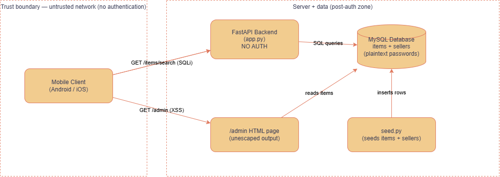

# C001 — Architecture, Data Flows and Trust Boundaries

## Components
- Mobile client (Android/iOS) — untrusted; anything it sends can be forged.
- FastAPI backend (app.py) — handles all endpoints; no authentication layer.
- MySQL database — stores the items table and the sellers table (the latter
  holds plaintext passwords, including the admin).
- seed.py — populates items and sellers on setup.
- /admin HTML page — served by the backend, renders item data with no access
  control and no output escaping.

## Data flows
- Client to Backend over HTTP/JSON: GET/POST/PATCH/DELETE on /items and
  /items/{id}, plus GET /items/search.
- Backend to MySQL: SQL queries — parameterised everywhere except the search
  endpoint, which builds SQL by string interpolation.
- /admin to MySQL: reads all items and renders them into HTML.
- seed.py to MySQL: inserts the seed items and seller accounts.

## Trust boundaries
- Client / Backend (left dashed zone): the main boundary, an untrusted network.
  Every input crossing it — query params, body fields, path params, and the
  PATCH JSON keys — is attacker-controllable. No authentication guards any
  route, so this boundary provides no real protection (C012).
- Backend / Data (right dashed zone): meant to be a protected server zone, but
  the search endpoint lets untrusted input cross straight into SQL (C007),
  which collapses the boundary.

## Key observations
- No authentication anywhere, so the client/backend boundary is effectively
  open (C012).
- Two paths carry untrusted input into SQL: GET /items/search (C007) and the
  PATCH endpoint's JSON keys (CX03).
- The /admin page trusts stored item data and renders it unescaped, so a stored
  payload executes in the admin's browser (C008).
- The sellers table holds plaintext passwords (C011), so any read access — e.g.
  via the search SQLi — exposes every credential.